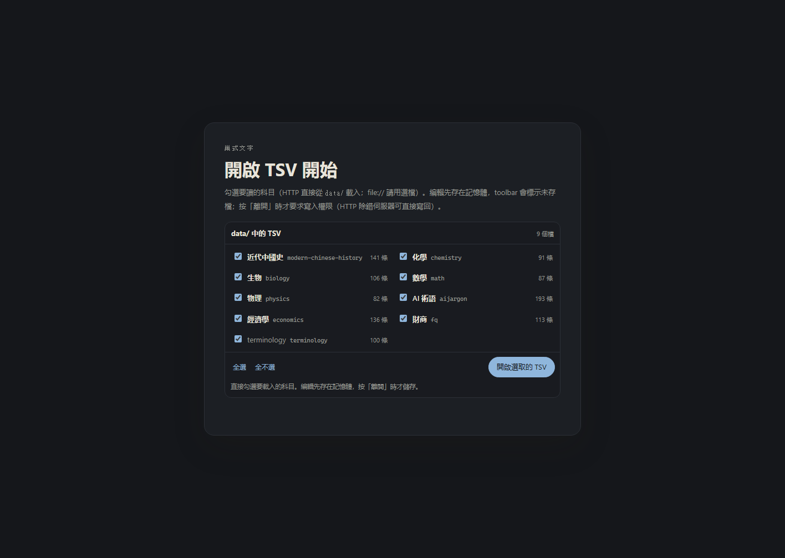
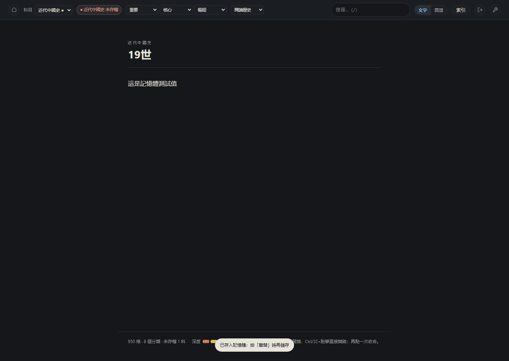
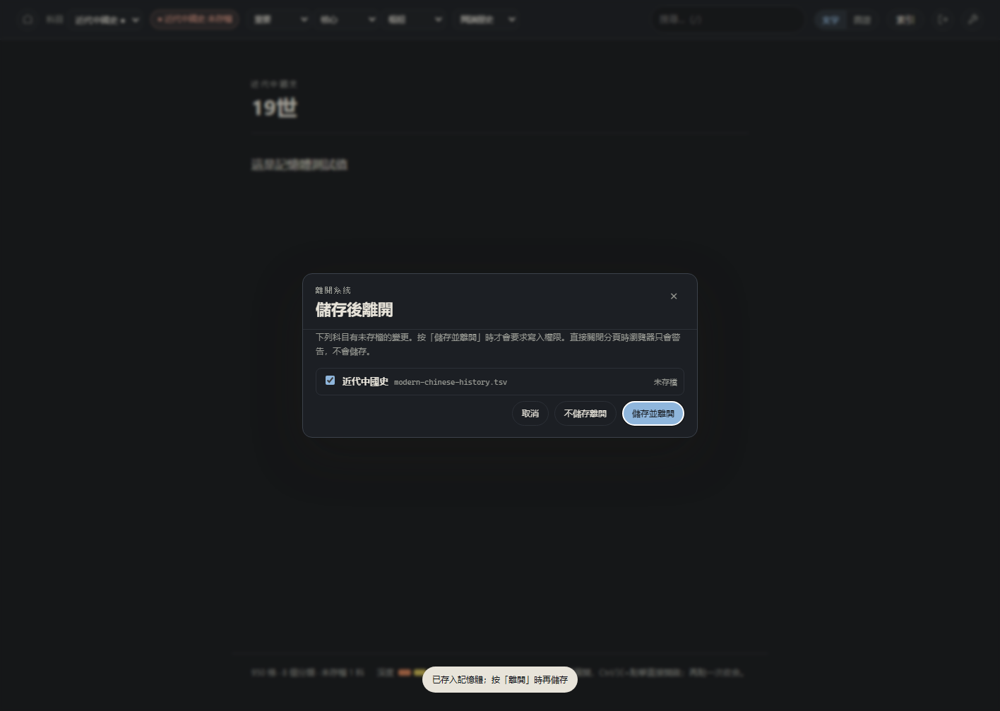
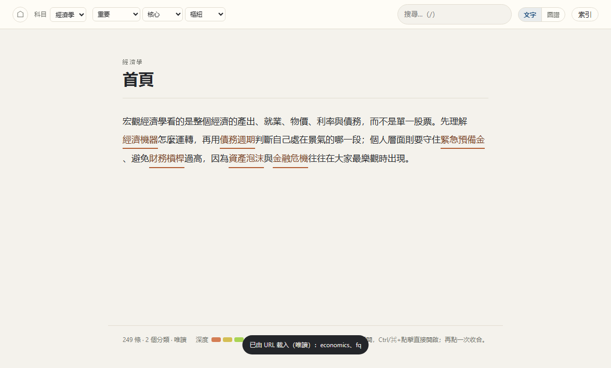
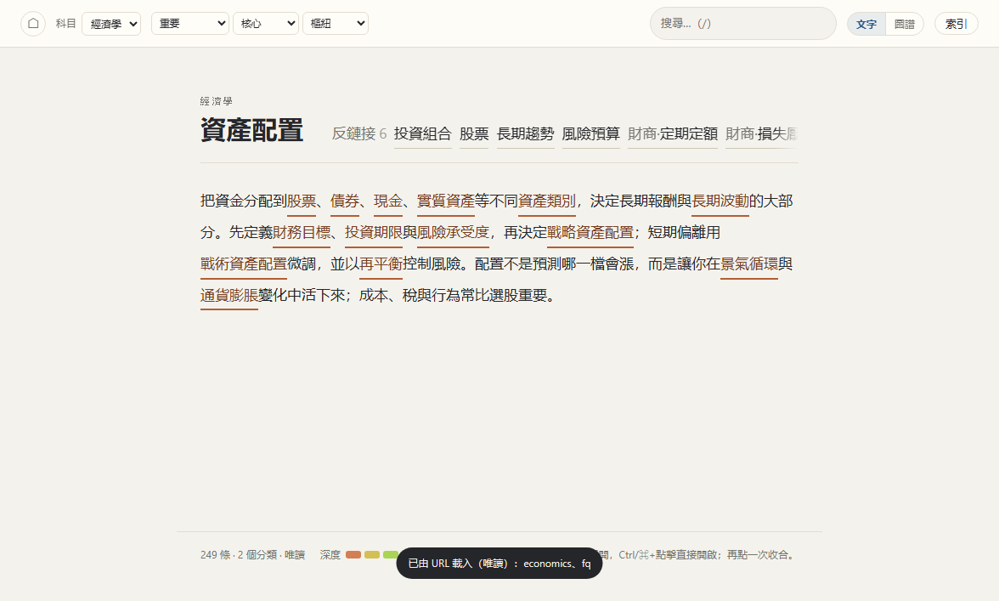
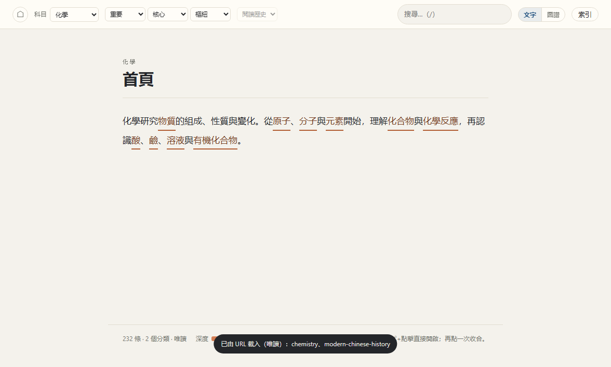
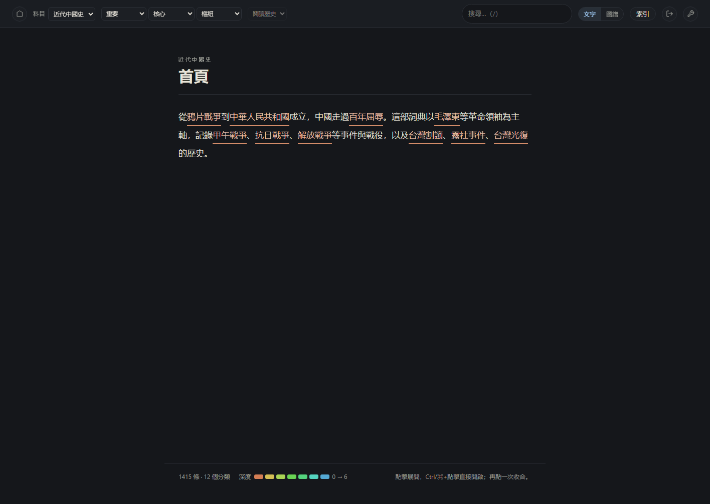
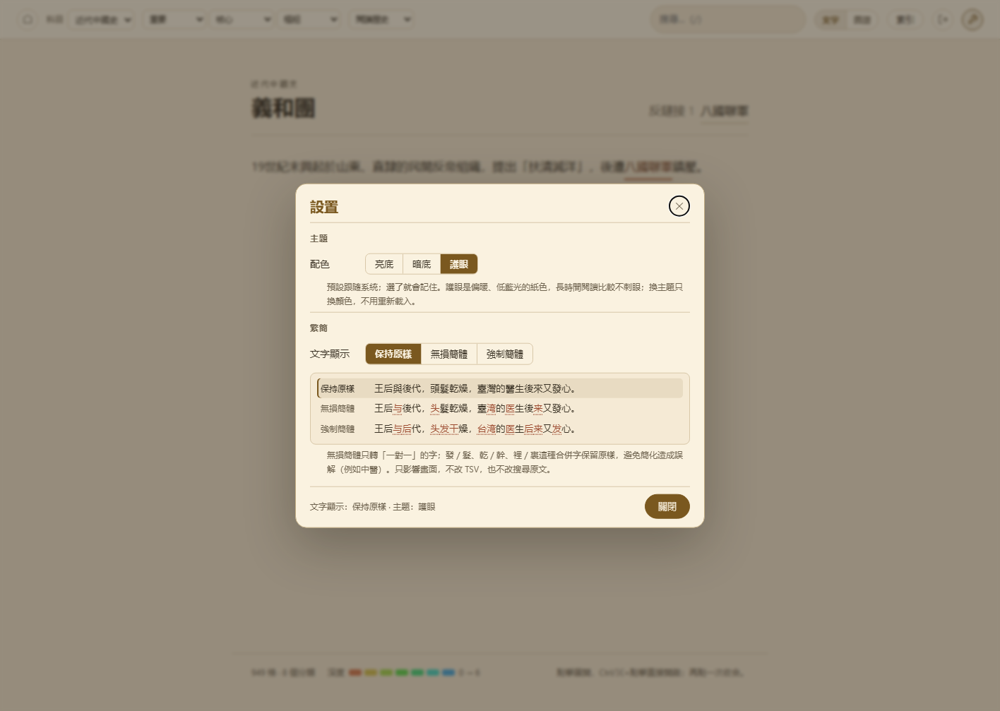
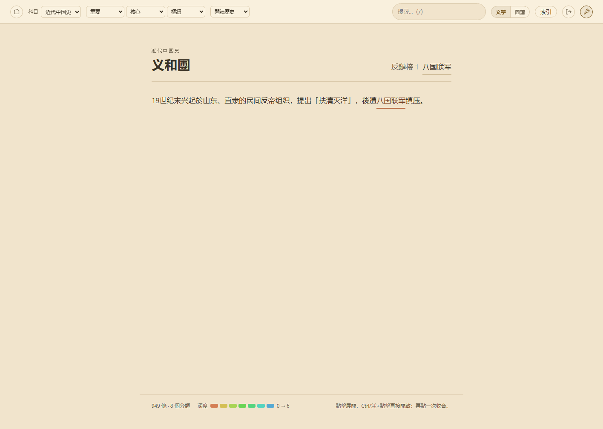

# 巢式文字 MVP

把 [nestedtext.md](nestedtext.md) 做成可點的單頁 HTML：`^[...]` 引用、多科目資料表、遞迴展開、深度色相。
單欄流式版面，沒有固定側欄；科目用頂欄選單切換，索引頁與搜尋涵蓋所有科目。
200 字以內的 value 在點擊處展開；引用是彩色文字加實線底線，沒有底色、沒有箭頭。
頂欄最右邊的扳手開啟設置頁，可切換亮底／暗底／護眼，以及保持原樣／無損簡體／強制簡體三態文字顯示（只影響畫面，不改資料）。
資料放在 `data/`，目前有 16 個科目：近代中國史、中國古代史、世界史、現代化歷程、化學、生物、數學、物理、地球科學、國語文、資訊科技、公民與法治、藝術、AI 術語、經濟學與財商。系統不預先打包 `data.js`；啟動頁會列出 `data/` 中的 TSV 供勾選（HTTP），`file://` 仍用本機選檔。編輯先存在記憶體、toolbar 標示未存檔，按「離開」時才要求寫入權限。

## 目錄結構

```text
.
├─ data/                    各科目 TSV
│  ├─ modern-chinese-history.tsv  近代中國史（141 條）
│  ├─ ancientchina.tsv      中國古代史（99 條）
│  ├─ worldhistory.tsv      世界史（112 條）
│  ├─ modernization.tsv     現代化歷程（101 條）
│  ├─ chemistry.tsv         化學（91 條）
│  ├─ biology.tsv           生物（106 條）
│  ├─ math.tsv              數學（87 條）
│  ├─ physics.tsv           物理（82 條）
│  ├─ earthscience.tsv      地球科學（105 條）
│  ├─ chinese.tsv           國語文（140 條）
│  ├─ computing.tsv         資訊科技（112 條）
│  ├─ civics.tsv            公民與法治（109 條）
│  ├─ art.tsv               藝術（91 條）
│  ├─ aijargon.tsv          AI 術語（193 條；222 對照頁不顯示）
│  ├─ economics.tsv         經濟學（136 條，可放開寫）
│  └─ fq.tsv                財商（113 條，可放開寫）
├─ nestedtext.md            規格
├─ basicofftag.md           標記語法
├─ goal.md                  設計目標
├─ prompt-guide.md          擴充科目的提示詞方針（給代理人）
├─ subject-spec.md          新科目 TSV 規格書（貼給對話式 AI）
├─ subject-questionnaire.md 新科目約束條件問卷（給人填）
├─ src/                     原始碼
│  ├─ index.html            頁面骨架、設置頁
│  ├─ nestedtext.css        版面、深度色相、亮／暗／護眼主題
│  ├─ nestedtext-core.js    解析、查表、別名、循環、鏈結／反鏈接／各科排行（瀏覽器與 Node 共用）
│  ├─ nestedtext.js         渲染、索引、搜尋、科目切換、路由
│  ├─ nestedtext-settings.js 設置頁：主題與繁簡三態
│  ├─ nestedtext-simplified.js 無損／強制簡體轉換
│  ├─ simplified-data.js    繁簡對照表（GENERATED）
│  └─ tools/                建置、測試、除錯腳本
└─ build/                   建置成果（可整個刪掉重建）
   ├─ index.html            直接開這個
   ├─ nestedtext*.js/css
   ├─ simplified-data.js
   ├─ tsv-manifest.js       啟動頁 TSV 清單（GENERATED，只列檔名）
   └─ shots/                展示截圖
```

`build/` 頂層每次建置都會重新產生；`build/shots/` 不會被清掉。

## 快速開始

```powershell
node src/tools/build.mjs
node src/tools/serve.mjs --port 8123
```

HTTP 模式開 [http://127.0.0.1:8123/build/index.html](http://127.0.0.1:8123/build/index.html)（或 `http://127.0.0.1:8123/`）。啟動頁會列出 `data/` 中所有 TSV，勾選後按「開啟選取的 TSV」即可；不用每次開檔案選擇器。`serve.mjs` 同時提供 `POST /api/tsv/<檔名>`，編輯後按「離開」可直接寫回 `data/`。

`file://` 仍然可用：直接開 [build/index.html](build/index.html)，啟動頁會顯示同一份 TSV 清單供對照，但受瀏覽器限制不能自動讀 `data/`，請按「選擇本機 TSV…」一次選取多個檔案。編輯同樣先存在記憶體；按「離開」儲存時才會要求該科 TSV 的寫入權限。

`build/` 只複製前端程式，不產生 `data.js`；`build/tsv-manifest.js` 只列 `data/` 的檔名與科目名稱，不含內容。改過 `src/` 後重跑建置；改過 `data/*.tsv` 則重新載入頁面即可。

## 啟動與未存檔



編輯後，toolbar 會顯示目前科目的「未存檔」，科目下拉也會在該科後面加 `●`：



按右上角離開圖示（扳手左邊）會列出未存檔科目，儲存時才要求寫入權限：




## 科目

| 科目 | 檔案 | 條目 |
| --- | --- | --- |
| 近代中國史 | [data/modern-chinese-history.tsv](data/modern-chinese-history.tsv) | 141 |
| 中國古代史 | [data/ancientchina.tsv](data/ancientchina.tsv) | 99 |
| 世界史 | [data/worldhistory.tsv](data/worldhistory.tsv) | 112 |
| 現代化歷程 | [data/modernization.tsv](data/modernization.tsv) | 101 |
| 化學 | [data/chemistry.tsv](data/chemistry.tsv) | 91 |
| 生物 | [data/biology.tsv](data/biology.tsv) | 106 |
| 數學 | [data/math.tsv](data/math.tsv) | 87 |
| 物理 | [data/physics.tsv](data/physics.tsv) | 82 |
| 地球科學 | [data/earthscience.tsv](data/earthscience.tsv) | 105 |
| 國語文 | [data/chinese.tsv](data/chinese.tsv) | 140 |
| 資訊科技 | [data/computing.tsv](data/computing.tsv) | 112 |
| 公民與法治 | [data/civics.tsv](data/civics.tsv) | 109 |
| 藝術 | [data/art.tsv](data/art.tsv) | 91 |
| AI 術語 | [data/aijargon.tsv](data/aijargon.tsv) | 193（另有 222 對照頁，不列入） |
| 經濟學 | [data/economics.tsv](data/economics.tsv) | 136 |
| 財商 | [data/fq.tsv](data/fq.tsv) | 113 |

索引頁全部共 1,818 條（不含各科首頁與 `@` 對照頁）；預設只列目前科目，可切「全部」或指定科目。

## 經濟學與財商

受眾是高中文化以上、財商仍在起步的人。目標不是報明牌，而是建立足以辨認陷阱的財務常識，克服「享樂主義」，避免因「急功近利」借錢投機。

- **經濟學**：以宏觀為主，採 Ray Dalio 的經濟機器、信貸與債務週期、去槓桿、央行與資產配置框架；也放入通膨、利率、匯率、景氣循環與金融危機。重點是讓讀者知道自己處在週期的哪一段，不要在最熱時全押。
- **財商**：採 Robert Kiyosaki 的資產／負債、現金流、現金流象限與財務報表，但補上行為偏誤、保險、稅務、詐騙與風險控制。特別強調「先存緊急預備金、再談投資」，以及保證高報酬、龐氏騙局、殺豬盤等常見陷阱。
- 兩科互相連結：經濟學提供環境判讀，財商提供個人現金流與行為紀律；內容是教育整理，不是投資建議。
- 兩檔都低於 200 詞；經濟學 136 詞、約 22.9KB，財商 113 詞、約 18.8KB。資產配置等主題不再受 20KB 限制，鏈結優先。





## HTTP 模式

`node src/tools/serve.mjs --port 8123` 會啟動只綁 `127.0.0.1` 的除錯伺服器：

- `GET /api/tsvs`：列出 `data/*.tsv`（檔名、id、名稱、是否 hidden、條目數）。
- `POST /api/tsv/<檔名>`：把 TSV 寫回 `data/`；會檢查第一行 meta 的 `id` 與檔名一致。
- 靜態檔從專案根目錄提供；`/` 預設開 `build/index.html`。
- 沒有快取，改完 `src/` 重跑 `build.mjs` 後重新整理即可。

也可以跳過勾選，直接用 query 指定要 fetch 的科目：

```text
http://127.0.0.1:8123/build/index.html?data=chemistry,modern-chinese-history
```

- `?data=` 用逗號分隔科目 id，對應 `data/<id>.tsv`；會依序 fetch、建立索引。
- 頁面在 `/build/` 時會自動嘗試 `data/` 與 `../data/`；也可用 `?dataBase=/data` 指定。
- HTTP 模式沒有檔案 handle，但**可以編輯**：修改先存在記憶體、toolbar 顯示未存檔；按「離開」儲存時走 `POST /api/tsv/`（若是一般靜態伺服器沒有這個 API，會退回「另存新檔」）。
- `?data=` 只在 http／https 有效；`file://` 會提示改用檔案選擇器。



## 部署到 shutonggui.cn/offtext/

```powershell
node src/tools/build.mjs
node src/tools/deploy-offtext.mjs --check   # 只檢查遠端連線與目錄
node src/tools/deploy-offtext.mjs           # 上傳 build/ 靜態檔與 data/*.tsv
```

- 目標：`https://shutonggui.cn/offtext/`（遠端 `/var/www/html/offtext`）。
- 連線沿用 `D:\2026\adb-converter\.local\server.env` 與 `.local/hostkey.txt`（PuTTY `pscp`／`plink`）；帳密不會被印出。
- 先傳到 `offtext.new`，完整後再換上，舊版留在 `offtext.prev`。
- 部署後會自動從 HTTPS 驗證首頁、manifest 與一份 TSV。
- 線上站是 Apache 靜態站：閱讀、搜尋、圖譜都正常；編輯先存在記憶體，但按「離開」儲存時沒有 `POST /api/tsv/`，會退回瀏覽器的「另存新檔」。要線上寫回需要另外加 CGI／PHP 端點。



## URL 參數

| 參數 | 作用 | 例 |
| --- | --- | --- |
| `#/domain/key` | 深連結到某個條目 | `#/modern-chinese-history/長征` |
| `#/index` | 索引頁（預設目前科目） | `#/index` |
| `#/index/<domain>` | 指定科目的索引；`all` 為全部科目 | `#/index/aijargon`、`#/index/all` |
| `#/graph/<domain>/<key>` | 以條目為起點的鏈結圖譜 | `#/graph/modern-chinese-history/長征` |
| `?depth=3&back=0` | 圖譜層數（1–3，預設 2）與方向開關 | `?depth=3&back=0#/graph/aijargon/人工神經元` |
| `?font=18&edge=long` | 圖譜字級（12–24px）與連線長度（short／medium／long） | `?font=18&edge=long#/graph/aijargon/人工神經元` |
| `?edgeWidth=thin`／`medium`／`thick` | 圖譜連線粗細（細／中／粗） | `?edgeWidth=thick#/graph/aijargon/人工神經元` |
| `?data=chemistry,modern-chinese-history` | HTTP 模式直接 fetch 指定科目 | `?data=chemistry,modern-chinese-history` |
| `?dataBase=/data` | 指定 HTTP 模式的 TSV 目錄 | `?data=modern-chinese-history&dataBase=/data` |
| `?theme=light`／`?theme=dark`／`?theme=eye` | 指定本次主題；沒有參數時用設定頁記住的值，沒選過則跟隨系統 | `?theme=eye` |
| `?mode=inline` 或 `?mode=block` | 預設展開形式 | `?mode=inline` |
| `?expand=0,0.2` | 預先展開指定路徑 | `?expand=0,0.0#/aijargon/人工神經元` |
| `?focus=0.2` | 指定焦點（搭配 `?expand`） | `?expand=1.0&focus=1.0` |
| `?q=細胞` | 載入時直接開搜尋結果 | `?q=細胞` |

## 已實作

- `^[引用]`、`^[顯示名|key]`、`^[key@domain]` 的解析。
- 十六個可見科目；頂欄科目選單切換：條目頁切到該科首頁，索引頁切換索引科目；「全部」回到全部科目的索引。
- 查表順序：**目前科目 → 其他科目**。同一科裡若有 `@` 轉址頁（例如 AI 術語的 `llm → @大型語言模型`），本科優先，所以生物的神經元與 AI 的人工神經元可以各自解析。
- 對照頁：value 以 `@` 開頭就轉址，支援 `@domain:key`，並偵測別名迴圈；每個 TSV 自給自足，中英（未來中日）對照頁都放在同一科檔案裡。對照頁只給系統查表，不進索引或搜尋；直接用網址開啟會跳到目標條目，編輯器也不能手動修改。
- 遞迴展開／再點收合；展開狀態以「引用出現位置的路徑」記錄。
- 循環引用：用祖先 key 集合判斷，顯示「↺ 循環」而不是無限遞迴；另有深度上限 6。
- 找不到、空值、深度上限都有對應提示，找不到時附上相近 key。
- 展開形式：200 字以內一律在點擊處內嵌，超過 200 字才放到段落之後；需要時可用 `?mode=inline`／`?mode=block` 覆寫。
- 行內展開只畫深度色底線，不加外框或底色；換行時不會每個 span 片段都多一圈框線。
- 引用是彩色文字 + 2px 實線底線，沒有底色、沒有箭頭；展開的 value 用深度色實線底線。
- `Ctrl`／`⌘` + 點擊引用：直接替換閱讀頁到該條目，不展開。
- 焦點模式：展開時只保留該條路徑清楚，其餘淡化；收合後恢復。
- 深度色相：HSV 每層 +30°，從暖橘（20°）漸變到冷藍；頁尾圖例顯示 0 → 6。
- 索引頁：科目分頁，預設只顯示目前科目（從哪一科進來就開哪一科），可切「全部」或指定科目；每頁只列一個科目，響應式格狀清單。
- 頂欄搜尋：即時結果、鍵盤上下鍵與 Enter、`/` 快速聚焦。
- 反鏈接：標題右側列出直接引用本條目的其他條目（與正文同字級）；前 4 筆直接顯示，第 5 筆起收進 `+N` 下拉，不再出現水平捲軸。點一筆跳到來源，並用加粗底線＋外框標出來源中指向原條目的引用，再點該引用即可回到原條目。反鏈接與圖譜用的順／逆鏈結都在 `NT.buildIndex()` 時一次算好（`index.links`），UI 不再重掃全部條目。
- 圖譜：以目前條目為起點，預設 2 層；HSV 深度色顯示親疏，節點字級可調 12–24px 並可軟換行，節點大小依總連結數增加；實線＝順鏈結、虛線＝逆鏈結；連線粗細可選 **細／中／粗**（預設中）；可選 1–3 層、三級連線長度、開關方向；點節點依序高亮順鏈→逆鏈→取消，`Ctrl`／`⌘`+點擊以該節點為新起點重繪，新中心會固定在畫布正中央，並把畫布中心對到視窗中心。跨科目節點加虛線外環與科目徽章；滑過節點顯示釋文。
- 圖譜節點：4 字以內一行，5 字起自動換行（最多 3 行），半徑最小約 18px、一般樞紐最大約 46px；長英文詞優先依複合詞尾換行，不把單字切一半。
- 圖譜設定是半透明浮窗，浮在畫布上、可收合成一行（狀態記在 `localStorage['offtext.graphPanel.v1']`）；收合後圖譜可以佔滿整個畫布。
- 頂欄三個單科排行下拉：**重要**＝順鏈多（重點節點）、**核心**＝逆鏈多、**樞紐**＝順鏈數 × 逆鏈數最大；只在目前科目內排名，各取該科前 12 名。下拉只顯示詞目，第一筆不再重複顯示「重要／核心／樞紐」；鏈結數放在 `title` hover hint（例如「順鏈 5」）。排行在 `NT.buildIndex()` 預先算好；選一個會直接開該條目（圖譜模式下以它為新起點）。索引「全部」時沒有單一科目，三個下拉會停用。
- 頂欄精簡：移除品牌字樣與「200 字內嵌」模式選單，搜尋框縮小；保留科目、三個排行、閱讀歷史、文字／圖譜、索引。
- 閱讀歷史：頂欄下拉保留最近 15 筆實際開啟的條目，最新的一筆排最前，重複閱讀會移到最前；存在瀏覽器 `localStorage`。選到未載入科目的舊紀錄時，會開「載入其他 TSV」視窗。
- 編輯詞目：在正文選取未標記名詞後按「＋ 新增詞目」。編輯**先存在記憶體**，toolbar 會顯示「● 未存檔」、科目下拉也會標 `●`；按右上角「離開」時才要求寫入權限並寫回 TSV。編輯器左側可過濾／插入現有名詞；之後在本科其他內文推荐可標記處，勾選確認即自動加 `^[...]`（同樣先存記憶體）。
- 缺科引用：只載入部分科目時，點到未載入科目的詞目（例如只開 `fq.tsv` 後點「資產配置」）會開「載入其他 TSV」視窗；加入後保留現有科目、重建索引，並直接跳到目標。載入只讀，編輯同樣先存記憶體。
- 離開系統：toolbar 的離開圖示（在扳手左邊）會列出未存檔科目；可「儲存並離開」或「不儲存離開」。直接關閉分頁時瀏覽器會警告，但不會自動儲存；請用離開按鈕。
- 文字／圖譜快速切換：頂欄「文字｜圖譜」 segmented control，保留目前條目；按 `g` 也可在兩者間切換（索引頁不適用）。
- 單欄流式版面：桌面最大 760px、手機全寬。
- 設置頁：頂欄最右邊的扳手圖示開啟，可切 **亮底／暗底／護眼** 三種主題，以及 **保持原樣／無損簡體／強制簡體** 三態文字顯示。選擇存在 `localStorage`（`offtext.theme.v1`、`offtext.simmode.v1`），重新載入仍保留；沒有選過主題時跟隨系統。文字轉換只影響畫面，TSV、索引與搜尋原文都不變。

## 設置頁

頂欄最右邊的扳手圖示（`#settingsBtn`）開啟設置頁。設定立即生效，關閉後不用重新載入：

- **主題**：亮底、暗底、護眼。只換 CSS 變數，不動版面；護眼是偏暖、低藍光的紙色，比亮底更黃。
- **繁簡文字顯示**：保持原樣、無損簡體、強制簡體。無損簡體只轉「一對一」的字；發／髮、乾／幹、裡／裏、臺／檯、後／后這類合併字保留原樣，避免簡化造成誤解。強制簡體則全部轉。
- 設置頁會用同一句範例並列三種結果，不同的字加虛線標出。
- 搜尋會同時接受原文、無損簡體與強制簡體；即使顯示簡體，打簡體字也找得到原文條目。
- 簡體顯示時仍可閱讀與展開引用，但不能用畫面選取新增／編輯詞目（選到的字不是 TSV 原文）；要編輯請先切回「保持原樣」。






## 查表順序

1. 引用若寫了 `@domain`，只在該科目找。
2. 先找**目前閱讀的科目**。
3. 再找其他科目。

每個 TSV 自給自足：同一科裡的中英（或中日）對照頁就是 value 以 `@` 開頭的轉址條目。所以在生物課本裡，「神經元」指生物的神經元；在 AI 術語裡，`神經元` 是一條轉址頁，會帶到 `人工神經元`。

## 科目詞典

- **近代中國史**：晚清到 1949 年，從鴉片戰爭、甲午戰爭、辛亥革命、抗日戰爭到解放戰爭，以毛澤東等革命領袖為主軸，並記錄台灣割讓、乙未戰爭、霧社事件與台灣光復。約 8.5K 字（限額 50K 內）。

近代中國史詞典以民族復興與革命史觀編寫，事件與日期以常見史料為準；歷史解釋多元，讀者宜對照其他資料。

- **化學**：物質分類、原子結構、週期表、化學式、化學反應、酸鹼鹽、溶液、氧化還原、有機與環境。
- **生物**：細胞與組織、植物運輸、人體系統、遺傳、演化、分類、生態系與保育。
- **數學**：數與運算、代數、方程式、函數、幾何、統計與機率。
- **物理**：力與運動、功與能、熱、波與光、電與磁、能源。
- **地球科學**：地球圈層、板塊構造、地震與火山、岩石與礦物、天氣與氣候、海洋、地質年代與天文。105 條。
- **國語文**：文字與六書、詞性與句子、修辭、文體、詩詞曲、四書五經、作家與名著、成語與標點。140 條。
- **資訊科技**：電腦硬體與軟體、數字系統與編碼、網路、演算法與程式、資料結構與資料庫、資訊安全、網頁與媒體識讀。112 條。
- **公民與法治**：國家與憲法、人民代表大會制度、公民權利與義務、民法典與刑法、訴訟、國家安全與民族團結。109 條。
- **藝術**：美術與音樂的基本要素、國畫與書法、西洋美術流派、樂器與曲種、戲曲與電影。91 條。
- **中國古代史**：從北京人、夏商周、秦漢、隋唐、宋元到明清，涵蓋制度、思想、科技與對外交流。99 條。
- **世界史**：從四大文明、古希臘羅馬、中世紀、文藝復興、工業革命到兩次世界大戰與冷戰。112 條。
- **現代化歷程**：以 1949 年開國後的第一個五年計劃到十四五規劃為軸線，串起工業化、改革開放、脫貧、生態文明與科技工程。101 條。
- **AI 術語**：從神經網絡、Transformer、LLM、訓練與推理，到 RAG、agent、MCP、多模態、GPU/HBM、量化與 AI 安全；已更新到推理模型、開放權重與代理工具鏈。193 條內容＋222 條中英對照頁。key 以中文為主（大型語言模型、檢索增強生成），品牌與語言名保留原文（OpenAI、Transformer、CUDA、Python）。
- **經濟學**：宏觀經濟機器、信貸與債務週期、去槓桿、央行與利率、通膨與通縮、匯率與國際收支、景氣循環、資產泡沫、風險與資產配置；以 Ray Dalio 的框架為骨幹，136 條。
- **財商**：資產與負債、現金流、財務報表、現金流象限、儲蓄與複利、延遲滿足、行為偏誤、保險與稅務、投資工具，以及龐氏騙局、殺豬盤、保證高報酬等陷阱；以 Robert Kiyosaki 的概念為起點，113 條。

每條是一到三句的定義，句中用 `^[...]` 連到其他條目；`_` 是該科首頁。自然科、近代中國史與 AI 術語的 key 直接用中文術語，`^[細胞]`、`^[大型語言模型]` 會直接命中；品牌、語言與架構名保留原文（`OpenAI`、`Python`、`Transformer`、`CUDA`）。英文縮寫與其他說法另立轉址頁（`llm → @大型語言模型`、`數據 → @資料`），打英文也查得到。

## 資料健檢

`node src/tools/audit.mjs` 對現有 1,818 個內容條目、2,165 個引用（另有 222 條 `@` 對照頁，不列入統計）跑出來的結果：

| 指標 | 數值 | 意義 |
| --- | --- | --- |
| 引用圖中會回到自己的條目 | **401 / 1,818** | 定義互相引用是常態 |
| 首頁可達的條目 | 近代中國史 35/141、中國古代史 33/99、世界史 19/112、現代化歷程 10/101、化學 41/91、生物 23/106、數學 10/87、物理 19/82、地球科學 39/105、國語文 42/140、資訊科技 13/112、公民與法治 18/109、藝術 22/91、AI 51/193、經濟 36/136、財商 29/113 | 首頁只是入口；索引與搜尋才是主要導覽 |
| 解析不到的引用名稱 | 0 個 | 十六科內容與對照頁全部指向存在的條目 |
| 壞掉的別名 | 0 個 | 舊版的 `agi`、`dice`、`chatmodel` 等別名都已補上 |

AI 術語改版時一併修掉舊版的 11 個斷鏈與 4 個壞別名，並清掉 `gen`、`generization`、`linearalgrebra` 等拼寫錯誤的舊 key。

另外用 `node src/tools/link-audit.mjs` 找出內文裡「已經是詞目、卻沒有 `^[...]` 標記」的提及；它會跳過既有引用、優先匹配較長的 key，並避開「民族解放戰爭」這類誤判。`--orphans` 只補「完全沒被其他條目引用」的詞目，避免把每個提及都過度連結；加 `--fix` 寫入，`--check` 適合放進檢查流程。經濟學與財商第一次跑時，前後合計補了 47 個孤兒詞目的鏈結。

## 已知限制

- 展開狀態只存在記憶體，沒有寫進 URL；分享連結只會還原到條目，不會還原展開樹。
- 每次點擊都整頁重繪。目前 1,000 餘條仍很輕，條目上萬或展開樹很大時需要局部更新。
- 三層以上的行內展開會疊很多底線，可切到「全部段後」閱讀。
- TSV 還沒有多行 value 的跳脫規則；目前 value 都必須是單行。
- 顯示名只做「名字 → key」的單向解析；`^[llm]` 會顯示 `llm`、連到「大型語言模型」，不會自動改顯示成中文。
- 對照頁（value 以 `@` 開頭）只供查表：不進索引與搜尋、不記入閱讀歷史；直接開它的網址會換成目標條目，編輯器也不允許手動修改。
- 反鏈接只列可見科目的內容條目，不含各科首頁；前 4 筆直接顯示，其餘用 `+N` 下拉，避免水平捲動。
- 圖譜是靜態佈局，沒有拖曳、縮放或動畫；節點上限 48，密集時只顯示前 48 個並提示降低層數。過長的詞目會軟換行成 1–3 行，完整名稱與釋文看 hover tooltip；canvas 會隨節點數變長，桌面與手機都不使用水平捲動。
- 編輯需要 Chromium／Edge 的 File System Access API（`file://`）或本專案的 `serve.mjs`（HTTP）。`file://` 第一次儲存時才要求該科寫入權限；存檔直接寫回該 TSV，下一次重新載入要重新選檔。編輯器目前只支援單行純文字 value。
- HTTP 沒有檔案 handle 時，儲存優先走 `POST /api/tsv/`；若是一般靜態伺服器（沒有這個 API），會退回 `showSaveFilePicker` 另存新檔。多科同時儲存時，權限提示可能要多按幾次。
- 未存檔只存在這個分頁的記憶體；直接關閉分頁或當掉不會保留。關閉前瀏覽器會警告，但真正的儲存要用右上角「離開」流程。
- 展開形式預設 auto，頂欄不顯示模式選單；需要時用 `?mode=` 覆寫。
- 無障礙只做了 `aria-expanded`、`aria-controls`、反鏈接 `nav` 標籤與鍵盤操作。

## 待決規格

- 同名 key 撞名時，要不要提供「選擇科目」而不是目前的「本科優先」？
- 展開狀態要不要寫進 URL（例如 `#/biology/細胞?e=0.2`）？
- 科目選單要不要改成首頁的科目卡片，而不是下拉選單？

## 檔案

| 檔案 | 作用 |
| --- | --- |
| [data/modern-chinese-history.tsv](data/modern-chinese-history.tsv) | 近代中國史 domain（141 條） |
| [data/chemistry.tsv](data/chemistry.tsv) | 化學 domain |
| [data/biology.tsv](data/biology.tsv) | 生物 domain |
| [data/math.tsv](data/math.tsv) | 數學 domain |
| [data/physics.tsv](data/physics.tsv) | 物理 domain |
| [data/aijargon.tsv](data/aijargon.tsv) | AI 術語 domain |
| [data/economics.tsv](data/economics.tsv) | 經濟學 domain（宏觀、債務週期、央行與資產配置） |
| [data/fq.tsv](data/fq.tsv) | 財商 domain（現金流、資產負債、行為偏誤與防詐） |
| [src/index.html](src/index.html) | 頁面骨架、設置頁 markup |
| [src/nestedtext.css](src/nestedtext.css) | 版面、深度色相、亮／暗／護眼主題、設置頁 |
| [src/nestedtext-core.js](src/nestedtext-core.js) | 解析、查表、別名、循環、鏈結／反鏈接／各科排行 |
| [src/nestedtext.js](src/nestedtext.js) | 渲染、索引、搜尋、科目切換、路由、設置整合 |
| [src/simplified-data.js](src/simplified-data.js) | 繁簡對照表（GENERATED，來自 accelon26 的 simplified-data.ts） |
| [src/nestedtext-simplified.js](src/nestedtext-simplified.js) | 無損／強制簡體轉換與搜尋形式 |
| [src/nestedtext-settings.js](src/nestedtext-settings.js) | 設置頁：主題、文字顯示三態、localStorage |
| [src/tools/serve.mjs](src/tools/serve.mjs) | 本機 HTTP 除錯伺服器：靜態檔、TSV 清單、寫回 API |
| [src/tools/deploy-offtext.mjs](src/tools/deploy-offtext.mjs) | 部署到 `shutonggui.cn/offtext/`（PuTTY pscp／plink） |
| [src/tools/live-check.mjs](src/tools/live-check.mjs) | 線上一頁式實測：清單、載入、無 JS 例外 |
| [src/tools/gen-simplified.mjs](src/tools/gen-simplified.mjs) | 從 accelon26 的 simplified-data.ts 重新產生對照表 |
| [src/tools/test-simplified.mjs](src/tools/test-simplified.mjs) | 繁簡三態單元測試 |
| [src/tools/http-test.mjs](src/tools/http-test.mjs) | Edge 實測 HTTP 啟動清單、記憶體編輯、未存檔、離開儲存 |
| [src/tools/settings-test.mjs](src/tools/settings-test.mjs) | Edge 實測：扳手、三主題、三態、搜尋、重載、手機寬度 |
| [src/tools/graph-test.mjs](src/tools/graph-test.mjs) | Edge 實測：圖譜設定浮窗收合、線粗、節點換行、Ctrl 重繪置中、手機寬度 |
| [src/tools/build.mjs](src/tools/build.mjs) | 建置：複製前端檔、產生 `tsv-manifest.js`，不打包 TSV 內容 |
| [src/tools/tsv-data.mjs](src/tools/tsv-data.mjs) | Node 端直接讀 TSV，供測試／健檢使用 |
| [src/tools/test-core.mjs](src/tools/test-core.mjs) | 核心邏輯測試 |
| [src/tools/click-test.mjs](src/tools/click-test.mjs) | 用 Edge DevTools 協定實際點擊、截圖 |
| [src/tools/audit.mjs](src/tools/audit.mjs) | 斷鏈、循環、可達性統計 |
| [src/tools/link-audit.mjs](src/tools/link-audit.mjs) | 找出未標記的詞目提及；可 `--fix` 自動補鏈結 |
| [src/tools/layout-check.mjs](src/tools/layout-check.mjs) | 窄螢幕水平溢出檢查 |
| [src/tools/dump.mjs](src/tools/dump.mjs) | 印出指定 URL 的展開狀態（除錯） |
| [build/index.html](build/index.html) | 建置後的入口；HTTP 直接勾選 TSV，file:// 用選檔 |
| [build/tsv-manifest.js](build/tsv-manifest.js) | 啟動頁的 TSV 清單（GENERATED，只列檔名） |

## 驗證

```powershell
node src/tools/build.mjs
node src/tools/serve.mjs --port 8123      # 另開一個終端機
node src/tools/test-core.mjs              # 解析、查表、別名、循環、模式選擇
node src/tools/test-simplified.mjs        # 無損／強制簡體轉換與搜尋形式
node src/tools/http-test.mjs              # HTTP 啟動清單 → 記憶體編輯 → 未存檔 → 離開儲存
node src/tools/live-check.mjs             # 線上 https://shutonggui.cn/offtext/ 實測
node src/tools/deploy-offtext.mjs --check # 檢查遠端部署目錄與權限
node src/tools/click-test.mjs             # 展開 → 循環 → 反鏈接 → 索引分頁 → Ctrl 點擊 → 圖譜（層數/字級/連線/hover）→ 單科排行下拉 → 文字/圖譜切換
node src/tools/settings-test.mjs          # 扳手位置 → 三主題 → 三態文字 → 簡體搜尋 → 重載記憶 → 索引/圖譜 → 手機寬度
node src/tools/graph-test.mjs             # 圖譜設定浮窗收合 → 線粗 → 節點換行/尺寸 → Ctrl 重繪置中 → 手機寬度
node src/tools/audit.mjs                  # 資料健檢
node src/tools/link-audit.mjs   # 找出未標記的詞目提及（--fix 自動補）
node src/tools/link-audit.mjs --file data/economics.tsv --orphans --check
```

`click-test` 會把截圖寫到 [build/shots/shot-clicked.png](build/shots/shot-clicked.png)，並確認整個過程沒有 JS 例外。


